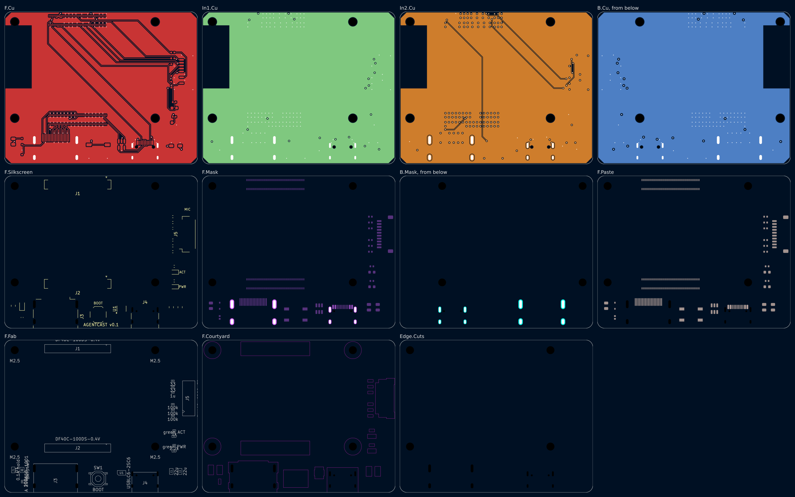
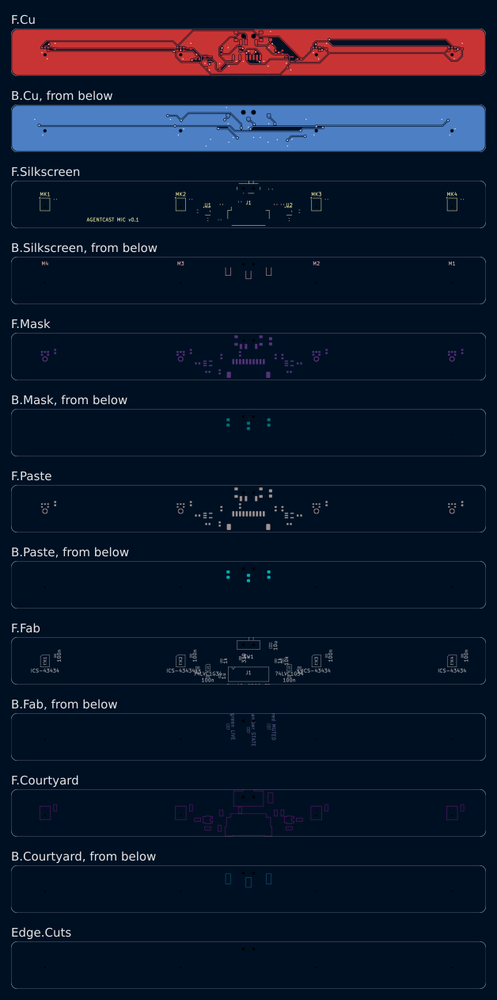
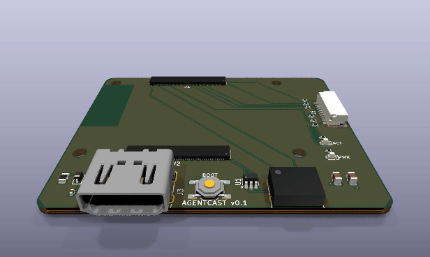
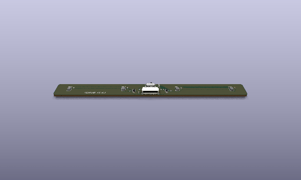
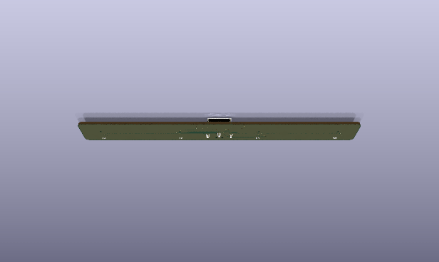
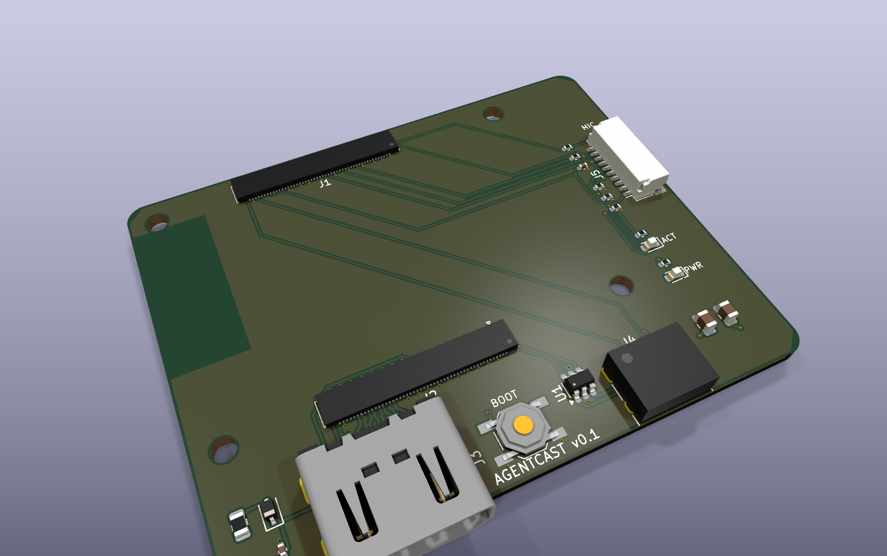
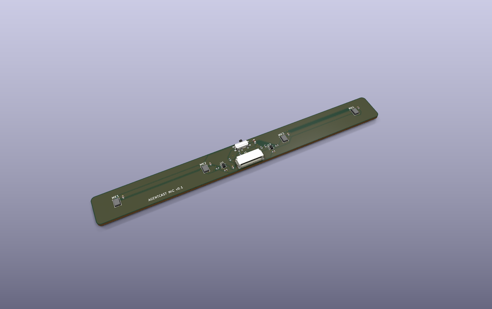
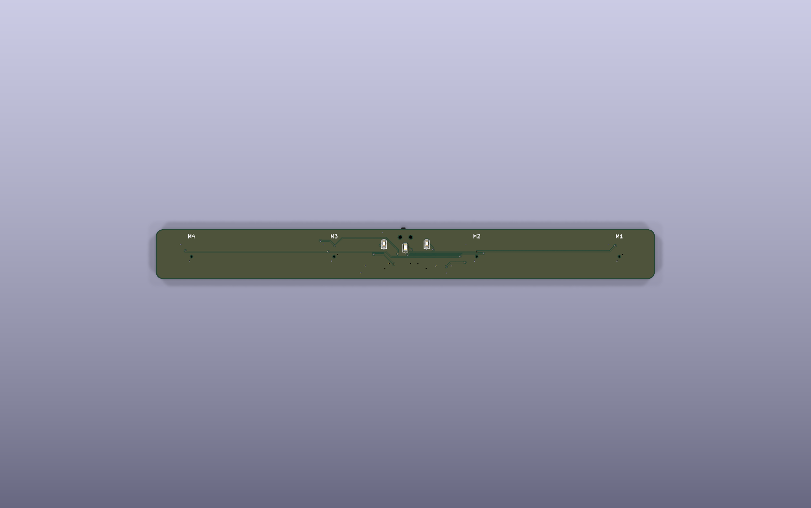

# Agentcast dongle v0.1

> **Archived** at commit `2c0782a`. Superseded by [v0.2](../v0.2/) (one board).
> First version. Made from the spec in
> [`docs/office-agent-dongle.md`](../../docs/office-agent-dongle.md) with the
> [Via EE Workcenter](https://github.com/ThyFriendlyFox/via).

v0.1 is two boards joined by a 10-way cable:

| Board | Folder | Size | Layers | What it does |
|---|---|---|---|---|
| Main board | [`main/`](main/) | 66 x 52.2 mm | 4 | Carries a Raspberry Pi Compute Module 5. HDMI-A out to the TV, USB-C power and flashing, boot button, 2 LEDs, mic bar socket. |
| Mic bar | [`micbar/`](micbar/) | 140 x 14 mm | 2 | 4 I2S MEMS mics on one shared clock, hardware mute switch, LIVE / MUTED / STATE LEDs. |





| Main board | Mic bar, from above | Mic bar, from below (LEDs, mic ports) |
|---|---|---|
|  |  |  |
|  |  |  |

The pictures come from `workcenter render <board> --views all --spin-frames 36`;
the mic bar's view from below adds `--views spin --spin-frames 36 --spin-tilt -125`.
Default zoom and pivot; the 0, 90, 180 and 270 degree test frames were whole.
The CM5 sockets and the USB-C receptacle use box bodies from `main/models/`
(KiCad has none).

Schematics: [`main/docs/schematic.png`](main/docs/schematic.png),
[`micbar/docs/schematic.png`](micbar/docs/schematic.png).

## Gate results

`workcenter gates` on each board, at the commit that adds this file:

| Board | ERC | DRC | SIM | EXPORT |
|---|---|---|---|---|
| main | PASS, 0 errors, 0 warnings | PASS, 0 errors, 0 unconnected, 0 parity; 4 silk warnings (HDMI and USB-C shells cross the edge, as designed) | SKIP, no deck (see Open items) | PASS, 24 Gerber files, drill, BOM, PDF |
| micbar | PASS, 0 errors, 0 warnings | PASS, 0 errors, 0 unconnected, 0 parity; 2 silk warnings (switch actuator crosses the edge) | PASS, 1 deck (`mic_live`) | PASS, Gerbers, drill, BOM, PDF |

## How it maps to the spec

| Spec requirement | v0.1 answer |
|---|---|
| HDMI dongle, the TV shows only what the dongle sends | CM5 HDMI0 to an HDMI-A receptacle (J3). A short HDMI cable goes to the TV, like a Chromecast tail. |
| Small, cheap, the cloud does the work | A CM5 module does Wi-Fi, HDMI 2.0 and I2S. The carrier has 26 parts. |
| A separate power supply, not the TV's USB port | USB-C (J4). The CM5 negotiates 5 V up to 5 A on CC1/CC2 itself (CM5 datasheet 2.12.1). |
| Mic unit separate from the dongle body, on the TV, facing the room | The mic bar is its own board on a JST SH cable. |
| All mic channels, not one cleaned channel | 4 raw 24-bit channels on 2 I2S data lanes (I2S0_SDI[0], I2S0_SDI[1]). No DSP on the bar. |
| A fixed, known mic layout | 4 mics in a line, 40.0 mm pitch, 120 mm aperture, positions in `micbar/design.py`. |
| One shared clock | The CM5's I2S0 is the only clock master. All 4 mics take the same BCLK and WS. |
| A physical mute; the indicator tied to mic power | SW1 cuts the mics' supply. The green LIVE LED runs from that supply. The red MUTED LED runs from the switch's other throw. |
| Software cannot turn the mics on in secret | No GPIO can power the mics. The clock buffers also run from the switched supply, so muted mics cannot draw power through their clock pins. |
| People see the state from anywhere in the room | 3 LEDs on the bar's front face. The STATE LED is driven by the CM5 (GPIO6) for "waiting / active". |
| TV control over HDMI-CEC | HDMI pin 13 goes to the CM5's HDMI0_CEC. |
| Recovery without IT | A BOOT button (nRPIBOOT) and USB-C data for `rpiboot` flashing. |

Not in v0.1: wired Ethernet, a camera, a backup speaker, a fan, more than
4 mics. See Open items.

## Part choices

| Ref | Part | Why |
|---|---|---|
| main J1, J2 | Hirose DF40C-100DS-0.4V | The CM5 board-to-board sockets. 1.5 mm stack height (CM5 datasheet 4.1.1). |
| main J3 | Molex 208658-1001 HDMI-A, mid-mount | In KiCad's library; its PCB-edge mark sets the board edge. |
| main J4 | HRO TYPE-C-31-M-12 | Common 16-pin USB 2.0 receptacle. |
| main U1 | ST USBLC6-2SC6 | ESD on the USB D+/D- pair. |
| main F1, D1, C3 | 0.1 A PTC, BAT54WS, 100 nF | HDMI +5V (pin 18): limits a short, blocks back-feed from the TV. |
| main J5 / micbar J1 | JST SH SM10B-SRSS-TB | 10-way cable between the boards, same pinout both ends. |
| main R1, R2 | 33 ohm | Source termination for BCLK and WS on the cable. |
| main R3, R4, R5 | 100 k | Pull-downs: SD0, SD1 (tri-stated by the mics) and MIC_LIVE. |
| micbar MK1-MK4 | TDK InvenSense ICS-43434 | I2S output, 24-bit, bottom port. In KiCad's library. Two mics share one data line (L/R). |
| micbar U1, U2 | 74LVC1G34 | Clock buffers on the switched supply. LVC inputs have Ioff, so a powered clock into an unpowered buffer is safe. |
| micbar SW1 | C&K PCM12SMTR | Slide switch for mute, right-angle, out of the top edge. |
| micbar D1, D2, D3 | 0603 LEDs green, red, amber | LIVE, MUTED, STATE, on the front face (B.Cu). Amber for STATE: a white LED (Vf near 3 V) would not light reliably from a 3.3 V GPIO (VOH min 2.9 V, datasheet Table 8). |

KiCad has no CM5 symbol and no 2 x 50 generic connector, so
[`library/gen_library.py`](library/gen_library.py) writes `CM5_J1` and
`CM5_J2` from [`library/cm5_pins.csv`](library/cm5_pins.csv). The CSV was
parsed from the CM5 datasheet pinout table (section 4.2), all 200 pins.
The same script copies KiCad's ICS-43434 with SD as tri-state.

## Pin plan (CM5)

Read from the CM5 datasheet: the GPIO alternate-function table (section 2.9)
and the pinout (section 4.2). GPIO_VREF (pin 78) is tied to CM5_3.3V, so all
GPIO are 3.3 V.

| Signal | CM5 pin | GPIO | Function | Goes to |
|---|---|---|---|---|
| MIC_BCLK | 49 | GPIO18 | I2S0_SCLK (alt a2), master | R1, J5.3 |
| MIC_WS | 26 | GPIO19 | I2S0_WS (alt a2) | R2, J5.5 |
| MIC_SD0 | 27 | GPIO20 | I2S0_SDI[0] (alt a2) | J5.6, mics 1-2 |
| MIC_SD1 | 46 | GPIO22 | I2S0_SDI[1] (alt a2) | J5.7, mics 3-4 |
| MIC_LIVE | 34 | GPIO5 | input, high = mics powered | J5.8 |
| STATE_LED | 30 | GPIO6 | output, high = LED on, about 2.7 mA | J5.9 |
| LED_nACT | 21 | - | activity LED sink, 20 mA max | D3 |
| nRPIBOOT | 93 | - | boot from USB when low | SW1 |
| CC1 / CC2 | 94 / 96 | - | USB-C PD | J4 |
| USB_P / USB_N | 105 / 103 | - | USB 2.0 (OTG ID left open: device mode for rpiboot) | J4 via U1 |
| HDMI0 TX2/TX1/TX0/CLK | 170-190 (even) | - | TMDS | J3 pins 1-12 |
| HDMI0_CEC / HOTPLUG | 151 / 153 | - | 5 V tolerant, direct to the connector | J3.13 / J3.19 |
| HDMI0_SDA / SCL | 199 / 200 | - | 5 V tolerant, 1.8 k pull-ups inside the CM5 | J3.16 / J3.15 |
| 5V | 77-87 (odd) | - | 4.75-5.25 V in | In2.Cu +5V pour |
| CM5_3.3V | 84, 86 | - | out, 600 mA total | GPIO_VREF, mic bar |

Shared-resource checks: I2S0 is one block, so SDI[0] and SDI[1] share its
BCLK and WS by construction. GPIO18-22 have no second use on this board.
Nothing off the board reaches a GPIO but the cable; every cable signal is
powered from CM5_3.3V, which is off when the CM5 is off (datasheet 4.2.1,
"Reverse voltage").

## Mic bar cable (J5 on main, J1 on the bar)

| Pin | Net | Notes |
|---|---|---|
| 1 | +3V3 | CM5_3.3V to the mute switch |
| 2, 4, 10, MP | GND | |
| 3 | BCLK | 33 ohm at the CM5 end |
| 5 | WS | 33 ohm at the CM5 end |
| 6 | SD0 | mics 1 (L), 2 (R) |
| 7 | SD1 | mics 3 (L), 4 (R) |
| 8 | MIC_LIVE | 10 k from the mics' supply, 100 k pull-down on the main board |
| 9 | STATE_LED | CM5 GPIO6 to the amber LED through 330 ohm |

## External contacts

| Board | Contact | Position (board origin top-left) | Nets |
|---|---|---|---|
| main | J3 HDMI-A | bottom edge, centre x 17.45 mm | TMDS, CEC, DDC, HPD, +5VP, GND |
| main | J4 USB-C | bottom edge, centre x 48.0 mm | +5V, CC1, CC2, USB_DP, USB_DN, GND |
| main | J5 mic bar | right edge, centre y 20.0 mm | see the cable table |
| main | SW1 BOOT | x 32.0, y 47.5 mm | nRPIBOOT, GND |
| micbar | J1 cable | bottom edge, centre x 70.0 mm | see the cable table |
| micbar | SW1 mute | top edge, centre x 70.0 mm | +3V3, MIC_VDD, MUTED |
| micbar | MK1-MK4 ports | x 10, 50, 90, 130 mm; y 7.71 mm | sound holes, 0.5 mm |

## HDMI routing

The four TMDS pairs are drawn by hand in `route_tmds()` (main/design.py) on
F.Cu, over the In1.Cu ground plane. Width 0.2 mm, gap 0.2 mm. On the
JLC04161H-7628 stackup (prepreg 0.2104 mm, er 4.4) that is 104 ohm
differential by Hammerstad-Jensen microstrip and the edge-coupled
approximation; the fab confirms the width for 100 ohm when the order asks
for impedance control. Within each pair the board traces match:

| Pair | P | N | Skew |
|---|---|---|---|
| D2 | 4.986 mm | 4.986 mm | 0.000 mm |
| D1 | 4.861 mm | 4.861 mm | 0.000 mm |
| D0 | 4.861 mm | 4.861 mm | 0.000 mm |
| CK | 4.986 mm | 4.986 mm | 0.000 mm |

The CM5 asks for 0.15 mm within a pair and 25 mm between pairs (datasheet
2.5.1). A V-bump on the shorter trace evens out the 45-degree jogs. There is
no ESD part on the TMDS lines: the CM5 datasheet (2.5.1) says the Raspberry
Pi 5 has none and it is not typically required.

## Simulation

`micbar/sim/mic_live.cir` checks the MIC_LIVE level at the CM5's GPIO5 at
its corners (CM5_3.3V at -5 %, resistors at 1 %, 3 uA leakage, datasheet
Table 8):

| Case | Limit | Result | Hand check |
|---|---|---|---|
| Live | >= 2.0 V (VIH) | 2.817 V | 3.135 x 99 / 109.1 - 3 uA x 9.165 k = 2.817 V |
| Muted | <= 0.8 V (VIL) | 0.303 V | 3 uA x 101 k = 0.303 V |

## Fab notes

- Main board: 4 layers, 1.6 mm, JLC04161H-7628 stackup or equal, with
  impedance control on the TMDS pairs (100 ohm differential, L1 to L2).
  Stack: F.Cu signal, In1.Cu GND plane, In2.Cu +5V pour, B.Cu signal.
  Smallest features: 0.15 mm track and gap, 0.45 mm via with a 0.25 mm hole.
- Mic bar: 2 layers, 1.6 mm, 0.2 mm track, 0.15 mm gap, 0.6/0.3 mm via.
- Both: parts on the top face only, except the mic bar's 3 LEDs (bottom).
  References of 0402/0603 parts are on the fab layer only.

## Open items

1. **CM5 socket positions.** J1, J2 and the 4 holes come from CM5 datasheet
   Figure 4, which is approximate. Check them against Raspberry Pi's CM5
   design files (KiCad / STEP) before ordering boards.
2. **HDMI +5V level.** With USB-C at 4.75 V, the BAT54WS drop leaves about
   4.4 V at HDMI pin 18; HDMI asks for 4.8 V minimum at the sink. Many TVs
   accept it, but v0.2 should replace D1 with a load switch (for example
   the TPD12S016's). No deck checks it yet: it needs a sourced BAT54 model
   (Via P27).
3. **Main board SIM deck.** None in v0.1. Candidates: the HDMI +5V path
   above and the LED currents.
4. **USB-C current.** The CM5 can ask for 5 A. Check the J4 part's VBUS
   rating against the CM5's measured load; v0.1 expects under 3 A.
5. **Echo reference clock.** The HDMI audio clock and I2S0 come from
   different blocks of the CM5. Echo cancellation needs the playback and
   capture clocks locked or measured. Test it on the first boards.
6. **Mic bar mounting.** The bar stands on its long edge. It needs a
   bracket or a case; the mics' ports face the B.Cu side.
7. **TDM / more mics.** I2S0 has 4 data lanes (GPIO20, 22, 24, 26). v0.1
   uses 2. A v0.2 bar could add 4 mics on GPIO24 and GPIO26.
8. **Mute switch direction.** Check which slider end is LIVE on the first
   article and mark it on the case.

## Commands

```bash
make design     # regenerate and route both boards (from the repo root)
```

```bash
make verify     # lint, then workcenter gates on both boards
```

```bash
workcenter render hardware/v0.1/main --views all --spin-frames 36
```
