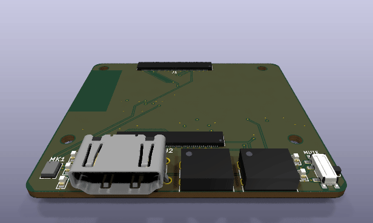
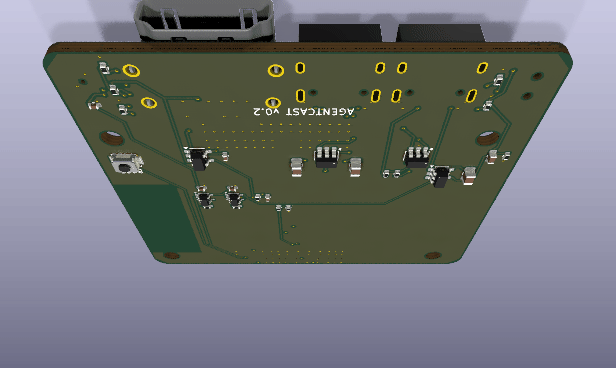
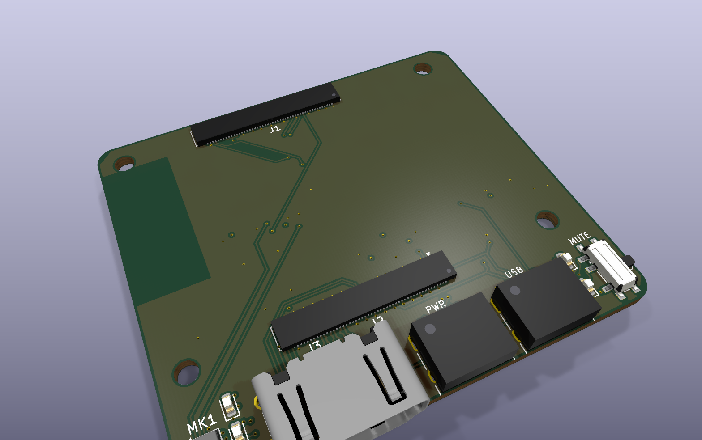
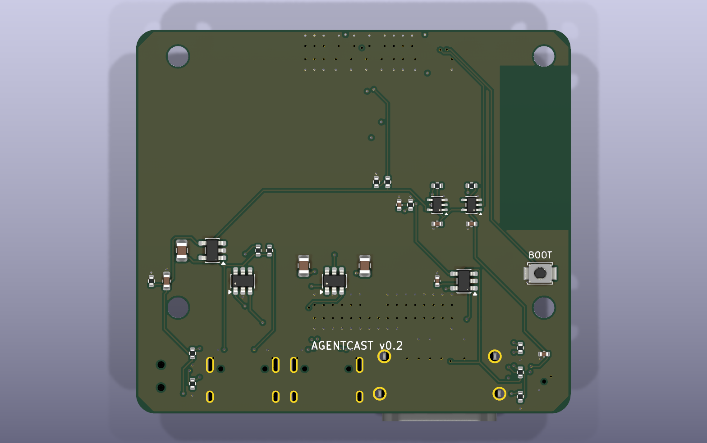
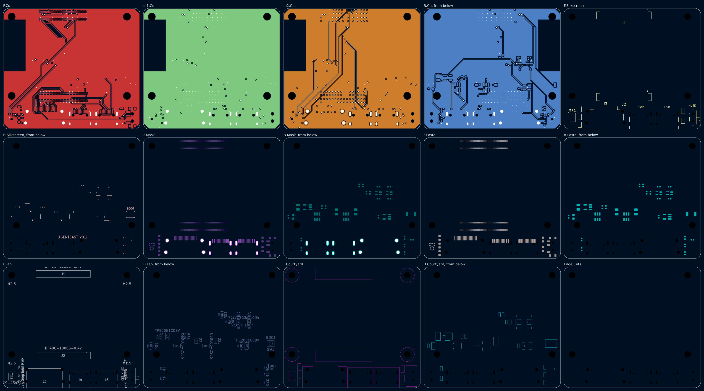

# Agentcast dongle v0.2

> **In work.** Made from [v0.1](../v0.1/) (commit `2c0782a`). v0.2 folds the
> two v0.1 boards into one: the mic bar, its cable and its 4-mic array are gone.

One board, 57 x 50.4 mm, 4 layers. A Raspberry Pi Compute Module 5 sits on
top; the board is 2 mm wider and 10.4 mm taller than the module.

| v0.1 | v0.2 |
|---|---|
| Main board 66 x 52.2 mm + mic bar 140 x 14 mm + cable | One board, 57 x 50.4 mm |
| 4 mics on the bar, for direction finding | 1 mic on the board, plus a USB-C port for an external USB mic |
| Mute switch on the bar | Mute switch on the board; it also cuts the external mic's power |
| HDMI +5V through a diode and a PTC | HDMI +5V through a TPS2051C switch (no diode drop, reverse blocking) |

Speakers are told apart by their voices, not by direction (the way Read AI
does it), so one good mic is enough. The external port takes a better mic
when a room needs one.

| From above | From below |
|---|---|
|  |  |
|  |  |



Schematic: [`dongle/docs/schematic.png`](dongle/docs/schematic.png).
The pictures come from `workcenter render dongle --views all --spin-frames 36`;
the view from below adds `--views spin --spin-frames 36 --spin-tilt -125`.

## Fabrication files

[`dongle/fab/`](dongle/fab/) holds what a board house and an assembler need,
made by `make fab` at the commit that adds this file: the EXPORT gate's
Gerbers (`gerbers/`, with the drill file `.drl` and the job file), the BOM
(`bom.csv`), the schematic PDF, and a pick-and-place file for both faces
(`agentcast_dongle-pos.csv`, KiCad's CSV, mm). Run `make fab` again after a
design change. The pick-and-place coordinates are KiCad page
coordinates: the board's top-left corner is at (100, -100). The BOM lists
values and footprints; manufacturer part numbers for the passives are not
chosen yet (Via's `procurement` skill does that step).

**Do not order yet:** open item 1 (CM5 socket positions) is still open.

## Gate results

`workcenter gates dongle`:

| Gate | Result |
|---|---|
| ERC | PASS, 0 errors, 0 warnings |
| DRC | PASS, 0 errors, 0 unconnected, 0 parity; 4 silk warnings where the USB-C shells cross the edge, as designed |
| SIM | PASS, 1 deck (`mic_live`) |
| EXPORT | PASS, 24 Gerber files, drill, BOM, PDF |

## Layout

| Face | What sits there |
|---|---|
| F.Cu (top) | The CM5 on J1 and J2. Along the bottom edge, left to right: the mic (MK1), PWR / ACT / STATE LEDs, HDMI-A (J3), USB-C power (J4), USB-C external mic (J6), LIVE and MUTED LEDs, the mute switch (SW2, sticking out of the right edge). |
| B.Cu (bottom) | 29 small parts under the module: power switches, ESD, clock buffers, resistors, capacitors, and the BOOT button (SW1). |

The CM5's antenna corner (left edge) has no copper and no parts on any layer.

## How it maps to the spec

| Spec requirement | v0.2 answer |
|---|---|
| HDMI dongle, the TV shows only what the dongle sends | CM5 HDMI0 to an HDMI-A receptacle (J3). |
| A separate power supply | USB-C (J4). The CM5 negotiates 5 V up to 5 A itself (CM5 datasheet 2.12.1). |
| Hear the room; tell speakers apart | On-board ICS-43434 mic, 24-bit I2S. Speaker labels come from voice, in the cloud. |
| A better mic when the room needs it | USB-C host port (J6) for a USB mic, on the CM5's USB 3.0 port 0 (its USB 2.0 pair). |
| A physical mute; the indicator tied to mic power | SW2 cuts MIC_VDD. The green LIVE LED runs from MIC_VDD; the red MUTED LED from the switch's other throw. |
| Software cannot turn a mic on in secret | MIC_VDD powers the on-board mic, its clock buffers, and U3's enable, which powers J6. No GPIO can do either. |
| TV control over HDMI-CEC | HDMI pin 13 to the CM5's HDMI0_CEC. |
| Recovery without IT | BOOT button (nRPIBOOT) and USB data on J4 for `rpiboot`. |

## Part choices

| Ref | Part | Why |
|---|---|---|
| J1, J2 | Hirose DF40C-100DS-0.4V | The CM5 sockets. 1.5 mm stack height (CM5 datasheet 4.1.1). |
| J3 | Amphenol 10029449-001RLF HDMI-A | Surface-mount, flat on the board; its PCB-edge mark sets the edge. Replaces v0.1's Molex part, whose mounting style I could not confirm. |
| J4, J6 | HRO TYPE-C-31-M-12 | J4: power and flashing. J6: host port for an external mic, with 56 k Rp on each CC (default USB power). |
| U1, U4 | ST USBLC6-2SC6 | ESD on each USB 2.0 pair. |
| U2 | TI TPS2051CDBV | HDMI +5V: 0.5 A switch, current limit, reverse-current blocking (TPS2051C datasheet). EN from +3V3. |
| U3 | TI TPS2051CDBV | External mic power. EN from MIC_VDD (logic high turns it on, TPS2051C datasheet pin 4), so mute cuts it. |
| MK1 | TDK InvenSense ICS-43434 | I2S mic, 24-bit, bottom port, in KiCad's library. Its sound hole is at x 3.5, y 46.21 mm. |
| U5, U6 | 74LVC1G34 | BCLK and WS buffers on MIC_VDD. LVC inputs have Ioff, so a muted mic gets no power through its clock pins. |
| SW2 | C&K PCM12SMTR | Mute slide switch, right-angle, out of the right edge. |
| SW1 | Omron B3U-1000P | BOOT button, on the bottom face. |
| R11 | 100 k | Bleeds MIC_VDD down when muted and holds U3's enable low. |

## Pin plan (CM5)

Read from the CM5 datasheet: the GPIO alternate-function table (section 2.9)
and the pinout (section 4.2). GPIO_VREF (pin 78) is tied to CM5_3.3V.

| Signal | CM5 pin | GPIO | Function | Goes to |
|---|---|---|---|---|
| I2S_BCLK | 49 | GPIO18 | I2S0_SCLK (alt a2), master | U5, R1, MK1 |
| I2S_WS | 26 | GPIO19 | I2S0_WS (alt a2) | U6, R2, MK1 |
| MIC_SD0 | 27 | GPIO20 | I2S0_SDI[0] (alt a2) | MK1 (left channel) |
| MIC_LIVE | 34 | GPIO5 | input, high = mic powered | R4 / R5 |
| STATE_LED | 30 | GPIO6 | output, high = LED on | R12, D3 |
| LED_nACT | 21 | - | activity LED sink, 20 mA max | D4 |
| nRPIBOOT | 93 | - | boot from USB when low | SW1 |
| CC1 / CC2 | 94 / 96 | - | USB-C PD | J4 |
| USB_P / USB_N | 105 / 103 | - | USB 2.0, device mode for rpiboot | J4 via U1 |
| USB3-0-DP / DM | 134 / 136 | - | USB 2.0 pair of USB 3.0 port 0, host | J6 via U4 |
| HDMI0 TX2/TX1/TX0/CLK | 170-190 (even) | - | TMDS | J3 pins 1-12 |
| HDMI0_CEC / HOTPLUG | 151 / 153 | - | 5 V tolerant, direct | J3.13 / J3.19 |
| HDMI0_SDA / SCL | 199 / 200 | - | 5 V tolerant, 1.8 k pull-ups in the CM5 | J3.16 / J3.15 |
| 5V | 77-87 (odd) | - | 4.75-5.25 V in | In2.Cu +5V pour |
| CM5_3.3V | 84, 86 | - | out, 600 mA total | GPIO_VREF, SW2, U2 EN |

Shared-resource checks: I2S0 is one block, so the mic uses its own BCLK and
WS. GPIO18-20 have no second use. Every signal that reaches a GPIO comes from
CM5_3.3V or MIC_VDD, both off when the CM5 is off (datasheet 4.2.1,
"Reverse voltage").

## External contacts

Positions from the board's top-left corner.

| Contact | Position | Nets |
|---|---|---|
| J3 HDMI-A | bottom edge, centre x 17.2 mm | TMDS, CEC, DDC, HPD, +5VP, GND |
| J4 USB-C power | bottom edge, centre x 32.0 mm | +5V, CC1, CC2, USB_DP, USB_DN, GND |
| J6 USB-C external mic | bottom edge, centre x 43.0 mm | VBUS_HOST, CC1_H, CC2_H, USB_H_DP, USB_H_DN, GND |
| SW2 mute | right edge, centre y 45.5 mm | +3V3, MIC_VDD, MUTED |
| MK1 sound hole | x 3.5, y 46.21 mm, 0.5 mm | - |
| SW1 BOOT | bottom face, x 4.0, y 32.0 mm | nRPIBOOT, GND |

## HDMI routing

The four TMDS pairs are drawn by hand in `route_tmds()` on F.Cu over the
In1.Cu ground plane: 0.2 mm width, 0.2 mm gap, 104 ohm differential on the
JLC04161H-7628 stackup (Hammerstad-Jensen microstrip, edge-coupled). The fab
confirms the width for 100 ohm when the order asks for impedance control.

| Pair | P | N | Skew |
|---|---|---|---|
| D2 | 3.671 mm | 3.671 mm | 0.000 mm |
| D1 | 3.546 mm | 3.546 mm | 0.000 mm |
| D0 | 3.546 mm | 3.546 mm | 0.000 mm |
| CK | 3.671 mm | 3.671 mm | 0.000 mm |

The CM5 asks for 0.15 mm within a pair and 25 mm between pairs (datasheet
2.5.1). No ESD part on the TMDS lines: the CM5 datasheet (2.5.1) says the
Raspberry Pi 5 has none and it is not typically required.

## Simulation

`dongle/sim/mic_live.cir` checks the MIC_LIVE level at GPIO5 at its corners
(CM5_3.3V at -5 %, resistors at 1 %, 3 uA leakage, datasheet Table 8):

| Case | Limit | Result | Hand check |
|---|---|---|---|
| Live | >= 2.0 V (VIH) | 2.817 V | 3.135 x 99 / 109.1 - 3 uA x 9.165 k = 2.817 V |
| Muted | <= 0.8 V (VIL) | 0.303 V | 3 uA x 101 k = 0.303 V |

## Fab notes

- 4 layers, 1.6 mm, JLC04161H-7628 stackup or equal, with impedance control
  on the TMDS pairs (100 ohm differential, L1 to L2). F.Cu signal, In1.Cu GND
  plane, In2.Cu +5V pour, B.Cu signal.
- Smallest features: 0.15 mm track and gap, 0.45 mm via with a 0.25 mm hole.
- Parts on both faces: assembly is two-sided.
- References of small parts are on the fab layer only.

## Open items

1. **CM5 socket positions.** J1, J2 and the holes come from CM5 datasheet
   Figure 4, which is approximate. Check them against Raspberry Pi's CM5
   design files before ordering.
2. **HDMI +5V at a low input.** U2 drops about 5 mV at 55 mA, but a 4.75 V
   USB-C input still gives under HDMI's 4.8 V. With PD the CM5 asks for 5 V.
3. **Mic placement.** The dongle hangs behind the TV, which blocks sound
   (spec, "Hearing the room"). The on-board mic is for testing; a room may
   need the external USB mic.
4. **USB-C current.** Check J4's VBUS rating against the CM5's measured load.
5. **Echo reference clock.** HDMI audio and I2S0 come from different blocks
   of the CM5. Test playback-to-capture drift on the first boards.
6. **J6 power without VBUS_EN.** U3 follows the mute switch only. The CM5's
   VBUS_EN (pin 111) is not used.
7. **Mute switch direction.** Check which slider end is LIVE on the first
   article and mark it on the case.
8. **Size.** A smaller board needs a different stacking height (parts under
   the module) or a smaller computer than the CM5.

## Commands

```bash
make design     # regenerate and route (from the repo root)
```

```bash
make verify     # lint, then workcenter gates
```

```bash
make fab        # gates, then Gerbers, drill, BOM, PDF and pick-and-place into dongle/fab/
```
