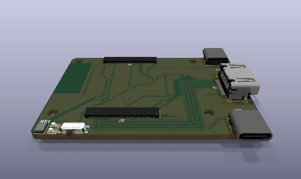
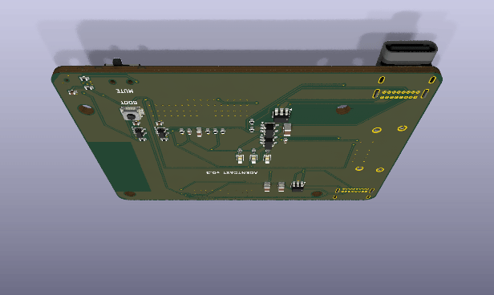
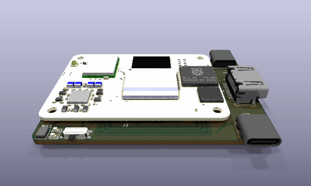
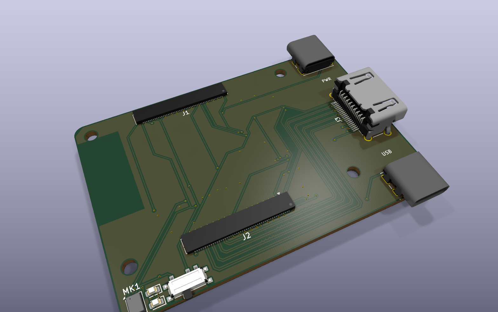
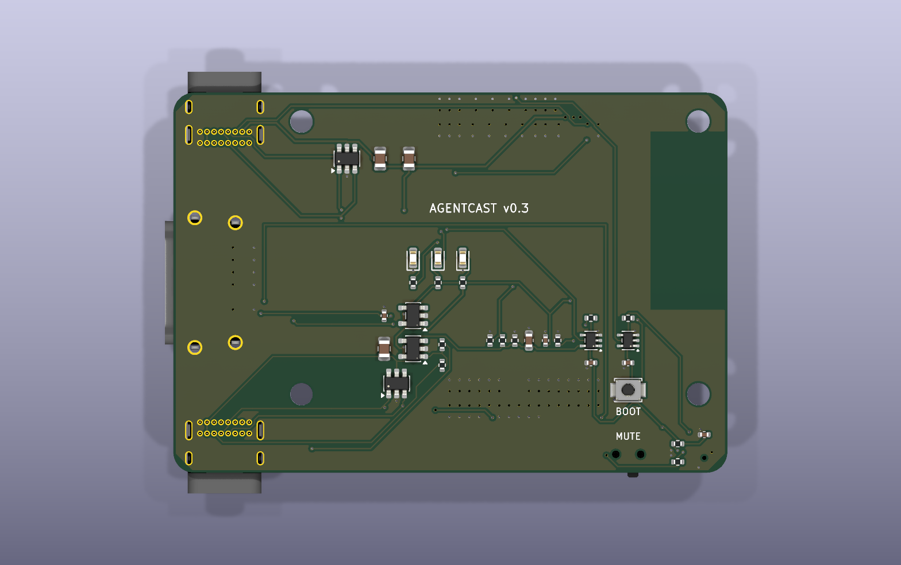
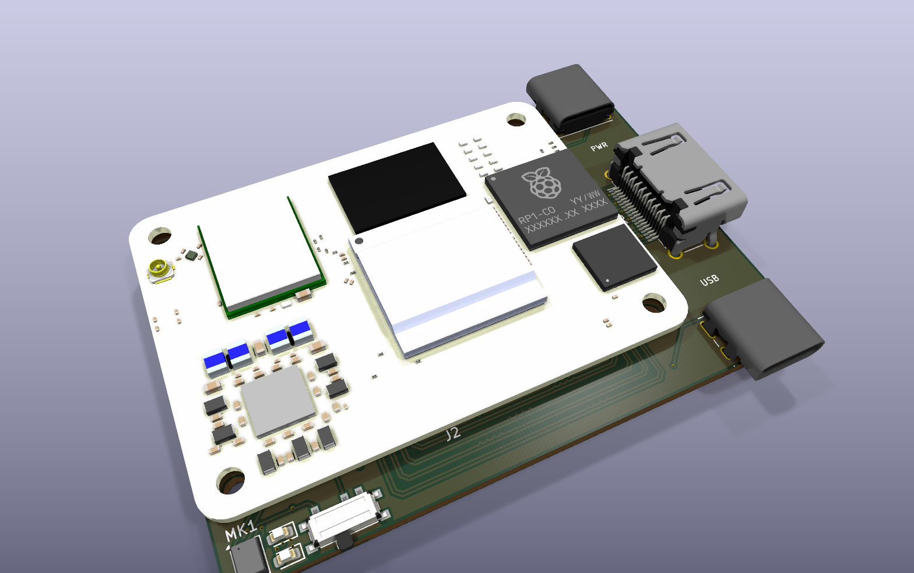
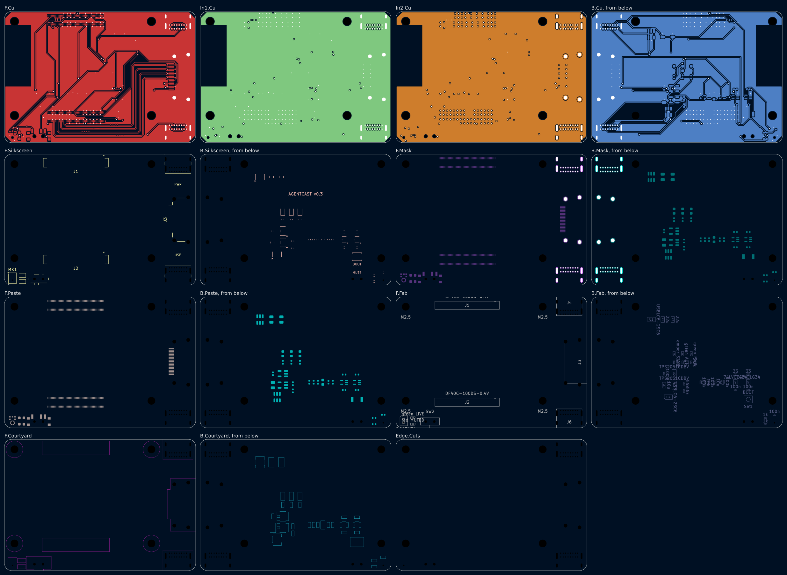

# Agentcast dongle v0.3

> **In work.** Made from [v0.2](../v0.2/) (commit `6d5fa2a`). v0.3 turns the
> one-board dongle into a stick: long and narrow, with the HDMI port at one end.

One board, 67 x 46 mm, 4 layers. A Raspberry Pi Compute Module 5 sits on top.

| | v0.2 | v0.3 |
|---|---|---|
| Size | 57 x 50.4 mm, nearly square | 67 x 46 mm, a stick |
| Ports | HDMI, both USB-C, mute switch all along one long edge | HDMI out of the end; USB-C power and USB-C external mic out of the two long sides beside it |
| USB-C part | HRO TYPE-C-31-M-12 (no 3D body in KiCad; drawn as a black box) | GCT USB4085, through-hole, with KiCad's 3D body |
| Inner layer 2 | +5V pour that signals were also routed through | +5V plane, nothing else on it |
| CM5 position | from datasheet Figure 4 | checked against Raspberry Pi's CM5 3D model |

| From above | From below | With the CM5 |
|---|---|---|
|  |  |  |
|  |  |  |



Schematic: [`dongle/docs/schematic.png`](dongle/docs/schematic.png).
Commands: `workcenter render dongle --views all --spin-frames 36 --strict`; the view
from below adds `--views spin --spin-frames 36 --spin-tilt -125`; the assembly
pictures come from `make assembly`.

## Why it is not narrower

The CM5 is 55 x 40 mm, so a stick built on it is at least 40 mm wide. v0.3 is
46 mm: 40 for the module and a 6 mm strip below it that carries the four HDMI
pairs, the mic, two LEDs and the mute switch. A Roku Streaming Stick is about
20 mm wide; that size needs a smaller computer than the CM5 (a v0.4 question).

## HDMI port: receptacle, not a plug

A Roku stick has an HDMI **plug** that goes straight into the TV. KiCad's library
has no board-mount HDMI plug, and I found no plug part with a published drawing
to make a footprint from: every board-mount HDMI-A part I found is a receptacle.
v0.3 keeps the Amphenol 10029449 receptacle at the stick's end, used with a short
male-to-male HDMI adapter or cable (the kind Roku ships as an extender). Give me
a plug part number with a drawing and v0.4 can take it.

## CM5 position, checked

Raspberry Pi's CM5 3D model (RP-007222-DD-2, "rpi-cm5 3D_STEP", from
[rpltd.co/cm5-design-files](https://rpltd.co/cm5-design-files)) gives, in the
module's frame (antenna edge at x = 0, y up):

| Feature | 3D model | This board |
|---|---|---|
| Board-to-board connectors (Amphenol 10164228-1001A1RLF) | centres (25.0, 3.0) and (25.0, 37.0) mm | J1, J2 at 25.0 mm from the antenna edge, 3.0 mm in from each long edge |
| M2.5 holes | (3.5, 3.5), (51.5, 3.5), (3.5, 36.5), (51.5, 36.5) mm, 2.7 mm | H1-H4 at the same points |
| U.FL | (2.567, 31.0) mm | matches datasheet Figure 4 (2.567 mm from the antenna edge, 9 mm from the top) |

The 3D model's connector names (P1, P2) do not follow the pin numbers, so which
socket carries pins 1-100 still comes from Figure 4's labels: the one nearer the
U.FL. The assembly pictures put Raspberry Pi's model on the board with these
numbers; its U.FL lands on the J1 side, as Figure 4 shows.

## Fabrication files

[`dongle/fab/`](dongle/fab/), made by `make fab`: Gerbers with the drill file
and job file (`gerbers/`), the BOM (`bom.csv`), the schematic PDF, and a
pick-and-place file for both faces (`agentcast_dongle-pos.csv`, KiCad CSV, mm,
page coordinates: the board's top-left corner is at (100, -100)). The BOM lists
values and footprints; part numbers for the passives are not chosen yet.

## Gate results

`workcenter gates dongle`:

| Gate | Result |
|---|---|
| ERC | PASS, 0 errors, 0 warnings |
| DRC | PASS, 0 errors, 0 unconnected, 0 parity; 4 silk warnings where the USB-C bodies and the mute switch cross the edge, as designed |
| SIM | PASS, 1 deck (`mic_live`) |
| EXPORT | PASS, 24 Gerber files, drill, BOM, PDF |

`workcenter render dongle --strict` passes: every part has a 3D body.

## Layout

| Where | What |
|---|---|
| Far end (x = 0) | The CM5's antenna. No copper and no parts under it, on any layer. |
| Under the module, F.Cu | J1, J2 and the HDMI pairs' risers. Nothing else: the module sits 1.5 mm above. |
| Strip below the module, F.Cu | Mic MK1 (sound hole at x 2.8, y 44.21 mm), LIVE and MUTED LEDs, mute switch SW2 (out of the long side), and the four HDMI pairs in lanes. |
| Near end, F.Cu | HDMI-A J3 (out of the end), USB-C power J4 (out of the top side), USB-C external mic J6 (out of the bottom side). |
| B.Cu | 32 small parts: power switches, ESD, clock buffers, PWR / ACT / STATE LEDs, resistors, capacitors, the BOOT button. |

## How it maps to the spec

| Spec requirement | v0.3 answer |
|---|---|
| HDMI dongle, the TV shows only what the dongle sends | CM5 HDMI0 to an HDMI-A receptacle (J3) at the stick's end. |
| A separate power supply | USB-C (J4). The CM5 negotiates 5 V up to 5 A itself (CM5 datasheet 2.12.1). |
| Hear the room; tell speakers apart | On-board ICS-43434 mic. Speakers are told apart by voice in the cloud, so one mic is enough. |
| A better mic when the room needs it | USB-C host port (J6) for a USB mic. |
| A physical mute; the indicator tied to mic power | SW2 cuts MIC_VDD. The green LIVE LED runs from MIC_VDD; the red MUTED LED from the switch's other throw. |
| Software cannot turn a mic on in secret | MIC_VDD powers the on-board mic, its clock buffers, and U3's enable, which powers J6. No GPIO can do either. |
| TV control over HDMI-CEC | HDMI pin 13 to the CM5's HDMI0_CEC. |
| Recovery without IT | BOOT button (nRPIBOOT) and USB data on J4 for `rpiboot`. |

## Part choices

| Ref | Part | Why |
|---|---|---|
| J1, J2 | Hirose DF40C-100DS-0.4V | The CM5 sockets. 1.5 mm stack height (CM5 datasheet 4.1.1). |
| J3 | Amphenol 10029449-001RLF HDMI-A | Surface-mount receptacle, flat on the board. See "HDMI port". |
| J4, J6 | GCT USB4085 | USB-C 2.0, through-hole pins: strong against a plug pulled sideways, and KiCad has its 3D body. J4: power and flashing. J6: host port with 56 k Rp on each CC. |
| U1, U4 | ST USBLC6-2SC6 | ESD on each USB 2.0 pair. |
| U2 | TI TPS2051CDBV | HDMI +5V: current limit and reverse-current blocking. EN from +3V3. |
| U3 | TI TPS2051CDBV | External mic power. EN from MIC_VDD, so mute cuts it. |
| MK1 | TDK InvenSense ICS-43434 | I2S mic, 24-bit, bottom port. |
| U5, U6 | 74LVC1G34 | BCLK and WS buffers on MIC_VDD (Ioff): a muted mic gets no power through its clock pins. |
| SW2 | C&K PCM12SMTR | Mute slide switch, out of the long side. |
| SW1 | Omron B3U-1000P | BOOT button, bottom face. |

## Pin plan (CM5)

Read from the CM5 datasheet: the GPIO alternate-function table (section 2.9)
and the pinout (section 4.2). GPIO_VREF (pin 78) is tied to CM5_3.3V.

| Signal | CM5 pin | GPIO | Function | Goes to |
|---|---|---|---|---|
| I2S_BCLK | 49 | GPIO18 | I2S0_SCLK (alt a2), master | U5, R1, MK1 |
| I2S_WS | 26 | GPIO19 | I2S0_WS (alt a2) | U6, R2, MK1 |
| MIC_SD0 | 27 | GPIO20 | I2S0_SDI[0] (alt a2) | MK1 (left channel) |
| MIC_LIVE | 34 | GPIO5 | input, high = mic powered | R4 / R5 |
| STATE_LED | 30 | GPIO6 | output, high = LED on | R12, D3 |
| LED_nACT | 21 | - | activity LED sink, 20 mA max | D4 |
| nRPIBOOT | 93 | - | boot from USB when low | SW1 |
| CC1 / CC2 | 94 / 96 | - | USB-C PD | J4 |
| USB_P / USB_N | 105 / 103 | - | USB 2.0, device mode for rpiboot | J4 via U1 |
| USB3-0-DP / DM | 134 / 136 | - | USB 2.0 pair of USB 3.0 port 0, host | J6 via U4 |
| HDMI0 TX2/TX1/TX0/CLK | 170-190 (even) | - | TMDS | J3 pins 1-12 |
| HDMI0_CEC / HOTPLUG | 151 / 153 | - | 5 V tolerant, direct | J3.13 / J3.19 |
| HDMI0_SDA / SCL | 199 / 200 | - | 5 V tolerant, 1.8 k pull-ups in the CM5 | J3.16 / J3.15 |
| 5V | 77-87 (odd) | - | 4.75-5.25 V in | a bar between J1's rows, 3 vias to the In2.Cu plane |
| CM5_3.3V | 84, 86 | - | out, 600 mA total | GPIO_VREF, SW2, U2 EN |

## HDMI routing

The four TMDS pairs are drawn by hand in `route_tmds()` on F.Cu over the In1.Cu
ground plane: 0.2 mm width, 0.2 mm gap, 104 ohm differential on the
JLC04161H-7628 stackup (Hammerstad-Jensen microstrip, edge-coupled). Each pair
leaves J2 downwards, runs in its own lane in the strip below the module, rises
beside the receptacle and turns into its pins. The lanes nest, so no pair
crosses another. V bumps on the inner trace of each pair even out the turns.

| Pair | P | N | Skew |
|---|---|---|---|
| D2 | 59.811 mm | 59.811 mm | 0.000 mm |
| D1 | 61.911 mm | 61.911 mm | 0.000 mm |
| D0 | 64.011 mm | 64.011 mm | 0.000 mm |
| CK | 66.111 mm | 66.111 mm | 0.000 mm |

The CM5 asks for 0.15 mm within a pair and 25 mm between pairs (datasheet
2.5.1); the pairs here differ by 6.3 mm at most.

Three nets are hand-routed where the router found no way: USB_H_DP and
HDMI_SCL each get a via just below their J2 pin (the HDMI lanes run under that
row), and HDMI_SCL runs on B.Cu across the board to a second via at J3 pin 15.

## Simulation

`dongle/sim/mic_live.cir` checks the MIC_LIVE level at GPIO5 at its corners:

| Case | Limit | Result | Hand check |
|---|---|---|---|
| Live | >= 2.0 V (VIH) | 2.817 V | 3.135 x 99 / 109.1 - 3 uA x 9.165 k = 2.817 V |
| Muted | <= 0.8 V (VIL) | 0.303 V | 3 uA x 101 k = 0.303 V |

## Fab notes

- 4 layers, 1.6 mm, JLC04161H-7628 stackup or equal, with impedance control on
  the TMDS pairs (100 ohm differential, L1 to L2). F.Cu signal, In1.Cu GND
  plane, In2.Cu +5V plane, B.Cu signal.
- Smallest features: 0.15 mm track and gap, 0.45 mm via with a 0.25 mm hole.
- Parts on both faces; J4 and J6 are through-hole.

## Open items

1. **HDMI plug.** The stick needs an adapter to plug into a TV (see "HDMI port").
2. **Width.** 46 mm is set by the CM5. Narrower needs a smaller computer.
3. **Part numbers** for the passives in the BOM.
4. **Mic placement.** Behind a TV the mic hears less; the external USB mic is the fallback.
5. **USB-C current.** Check J4's VBUS rating against the CM5's measured load.
6. **Echo reference clock.** HDMI audio and I2S0 come from different blocks of the CM5.
7. **Mute switch direction.** Mark which slider end is LIVE on the first article.

## Commands

```bash
make verify     # lint, then workcenter gates
```

```bash
make fab        # gates, then Gerbers, drill, BOM, PDF and pick-and-place into dongle/fab/
```

```bash
make assembly   # fetch the CM5 model and render the board with the module on it
```
