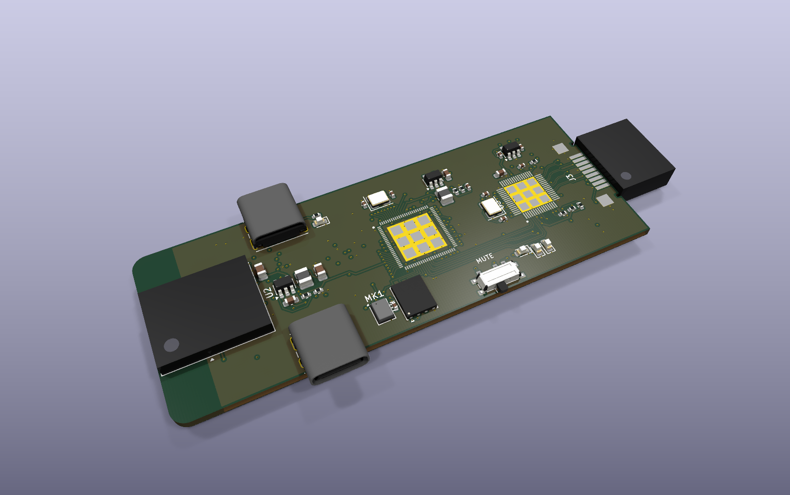
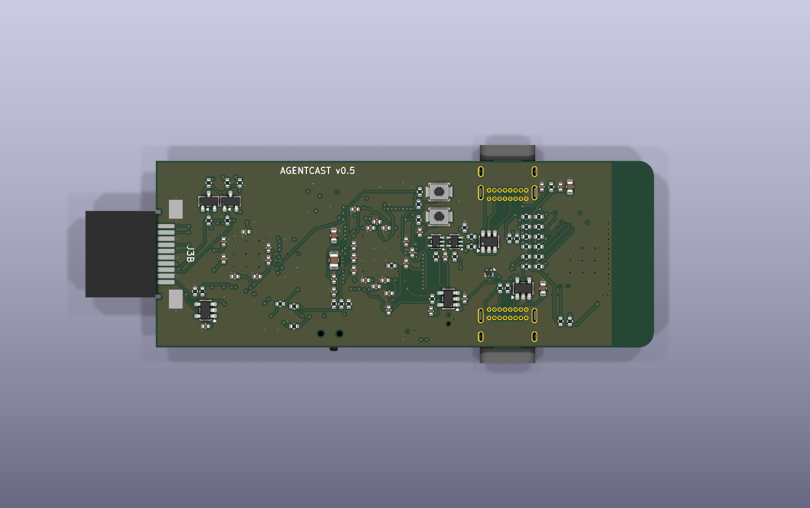
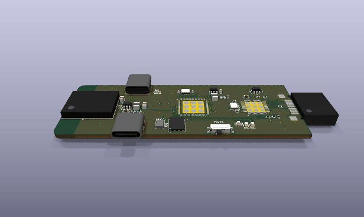
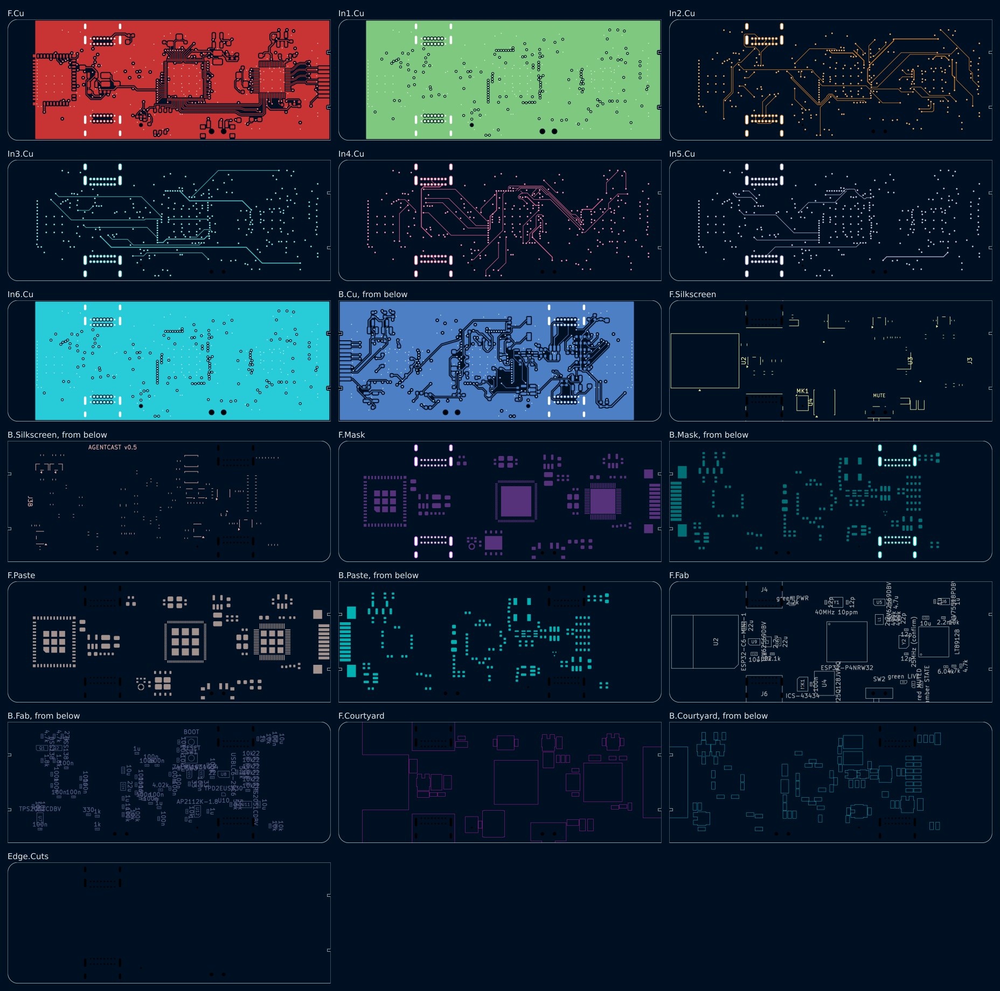

# Agentcast dongle v0.5

> **In work.** Made from [v0.4](../v0.4/) (commit `223e73b`). v0.5 drops the
> Raspberry Pi CM5 and puts our own small computer on a Chromecast-sized stick.

One board, **80 x 30 mm**, 8 layers, parts on both faces. A male HDMI plug
(XUNPU HDMI-003) clamps one end; the Wi-Fi antenna is at the other.

| | v0.4 | v0.5 |
|---|---|---|
| Size | 67 x 46 mm | 80 x 30 mm |
| Computer | Raspberry Pi CM5 module (55 x 40 mm, Linux) | ESP32-P4 (10 x 10 mm, 32 MB PSRAM in the package, no Linux) |
| HDMI | from the CM5 | LT8912B MIPI DSI to HDMI bridge, with HDMI audio |
| Wi-Fi | the CM5's | ESP32-C6-MINI-1 module (Wi-Fi 6), SDIO to the P4 |
| HDMI plug footprint | HDMI Type-A layout, 4 numbers unconfirmed | the XUNPU HDMI-003 drawing, every number |
| Layers | 4 | 8 (F.Cu, In1 GND, In2-In5, In6 GND, B.Cu), JLCPCB JLC081611-2116 |

| Top | Bottom | Turning |
|---|---|---|
|  |  |  |

Schematic: [`dongle/docs/schematic.png`](dongle/docs/schematic.png).

## Why no full computer

The dongle's jobs (spec, "How it works") are: hear the room and stream it to
the cloud agent, show what the agent made on the TV, and play the agent's
voice. The cloud does the thinking. None of that needs Linux or a browser on
the stick:

| Job | v0.5 |
|---|---|
| Hear the room | ICS-43434 I2S mic (or a USB mic on J6), streamed over Wi-Fi |
| Show the work | The cloud renders the dashboard and sends frames (JPEG, decoded by the P4's hardware JPEG codec); the P4 drives HDMI through DSI at 720p60 or 1080p30 |
| Speak | I2S audio into the LT8912B, out over HDMI to the TV's speakers |
| Echo cancellation | Mic capture and HDMI playback run on the same I2S clock (one BCLK, one WS) |
| Mute | SW2 cuts the power of both mics; LIVE / MUTED LEDs run from the switch |

What it gives up: the stick cannot run a web page by itself, so the cloud
renders the screen. A 2-lane DSI link at 1.5 Gb/s per lane (ESP32-P4 datasheet
4.2.1.7) carries 720p60 or 1080p30, not 4K.

## Parts

| Ref | Part | Why |
|---|---|---|
| U1 | Espressif ESP32-P4NRW32, QFN104 | 2 x RISC-V 400 MHz, 32 MB PSRAM in the package (no DDR to route), MIPI DSI, I2S, USB 2.0 HS, JPEG codec, H.264 encoder |
| U4 | Winbond W25Q128JVPIQ, WSON-8 | 16 MB flash for the firmware; top face, under the P4's flash pins |
| Y1 | 40 MHz, +/-10 ppm, 3225 | The P4 firmware supports 40 MHz only (Espressif hardware design guidelines, HDG 1.4.2) |
| U5, L1 | TI TLV62569 + 2.2 uH | The P4's core supply, under the P4's own control (EN_DCDC, FB_DCDC), exactly HDG Fig. 5 |
| U3 | Lontium LT8912B, QFN64 | MIPI DSI to HDMI 1.4 with I2S audio input |
| Y2 | crystal, 3225 | The LT8912B wants one on XTALI/XTALO; its datasheet gives no frequency (Open item 2) |
| U2 | Espressif ESP32-C6-MINI-1 | Wi-Fi 6, certified module with its antenna; SDIO slave on GPIO18-23 (ESP32-C6 datasheet, IO MUX) |
| J3, J3B | XUNPU HDMI-003 male HDMI-A plug | Clamps a 1.60 mm board; even contacts on top, odd on the bottom (manufacturer drawing) |
| J4 | GCT USB4085 USB-C | Power (5 V, 5.1k Rd on each CC) and the P4's USB serial/JTAG for flashing |
| J6 | GCT USB4085 USB-C | Host port for an external USB mic, on the P4's USB 2.0 HS; power via U11, which the mute switch enables |
| U9, L2 | TI TLV62569 + 2.2 uH | +3V3 from +5V, 0.6 V x (1 + 100k / 22.1k) = 3.31 V |
| U6 | TI TLV75518 | +1V8 for the LT8912B and the P4's IO bank 6 |
| U12 | Diodes AP2112K-1.8 | MIC_1V8 from the mute-switched MIC_3V3 |
| U7, U11 | TI TPS2051C | HDMI +5V (EN +3V3) and the external mic's VBUS (EN MIC_3V3); current limit and reverse blocking |
| Q1, Q2 | BSS138 | DDC (EDID) level shift, 5 V at the plug to 3.3 V at the P4 |
| U8 / U10 | USBLC6-2SC6 / TPD2EUSB30 | ESD on J4's full-speed pair / J6's high-speed pair (0.7 pF; HDG asks for under 1 pF on HS) |
| MK1 | TDK ICS-43434 | I2S mic, on MIC_1V8 |
| U13, U14 | 74LVC1G34 | Clock buffers on MIC_1V8: a muted mic gets no power through its clock pins (Ioff) |
| SW2 | C&K PCM12 | Mute slide switch, out of the long side |
| SW1, SW3 | Omron B3U | BOOT (GPIO35) and RESET (CHIP_PU), bottom face |

## Voltage domains

The LT8912B's I2C, I2S and reset pins are 1.8 V CMOS (LT8912B datasheet
Table 6.2.1). The P4 powers each GPIO bank separately (HDG, "HP/LP IO Power
Supply"), so bank 6 (GPIO49-54, VDD_IO_6) runs at 1.8 V and carries every
LT8912B and mic signal; the other banks run at 3.3 V.

| Rail | From | Feeds |
|---|---|---|
| +5V | J4 | U9, U7 (HDMI +5V), U11 (J6 VBUS), PWR LED |
| +3V3 | U9 | P4 VDD_LP, VDD_IO_0/4/5, VDD_ANA, VDD_BAT, VDD_LDO, VDD_DCDCC, VDD_USBPHY; C6; U5, U6 |
| VDD_HP (about 1.1 V) | U5 | P4 VDD_HP_0-3 |
| +1V8 | U6 | LT8912B, P4 VDD_IO_6 |
| VDDO_FLASH | P4's flash LDO (3.3 V default) | P4 VDD_FLASHIO, U4 |
| VDDO_PSRAM | P4's PSRAM LDO | P4 VDD_PSRAM_0/1 |
| VDD_MIPI | P4's VDDO_3, set to 2.5 V in firmware | P4 VDD_MIPI_DPHY (HDG: 2.25-2.75 V, internal regulator recommended) |
| MIC_3V3 | SW2 from +3V3 | U12, U11's enable, LIVE LED, MIC_LIVE sense |
| MIC_1V8 | U12 | MK1, U13, U14 |

## Pin plan (ESP32-P4)

From the ESP32-P4 datasheet v0.7 (Table 2-1) and the HDG. Every signal on a
GPIO goes through the GPIO matrix except USB serial/JTAG (GPIO24/25, IO MUX).

Signals the GPIO matrix can put anywhere sit on every other free pin, on the
side facing what they drive: neighbouring signal pins at 0.35 mm pitch leave
no room for their vias.

| GPIO (pin) | Bank | Net | Function |
|---|---|---|---|
| 10 / 12 (11 / 13) | 0, 3.3 V | C6_RXD / C6_TXD | UART to the C6, for flashing it from the P4 |
| 14 (15) | 0 | C6_BOOT | the C6's GPIO9 strap, open drain, 10k up |
| 16 (17) | 0 | C6_EN | C6 enable, open drain, 10k up + 1 uF |
| 17 (18) | 0 | LT_RST_N | LT8912B reset, open drain, 10k up to +1V8 |
| 18-23 (19, 20, 22-25) | 0 | SDIO_CLK, CMD, D0-D3 | SD/MMC host slot 2 (GPIO matrix) to the C6; 22 ohm series, 10k up (HDG 1.3.11) |
| 24 / 25 (52 / 53) | 4 | USB_FS_DN / DP | USB serial/JTAG to J4, 22 ohm series (HDG 1.3.12) |
| 27 (56) | 4 | MIC_LIVE | input, high = mics powered |
| 29 (58) | 4 | STATE_LED | amber STATE LED |
| 31 / 32 (61 / 63) | 4 | DDC_SDA_3V3 / SCL | I2C to the TV's EDID through Q1 / Q2 |
| 35 (66) | 4 | BOOT | strapping: low at reset = download mode (HDG Table 4); 10k up, SW1 |
| 36 (68) | 4 | GPIO36_PU | strapping, 10k up |
| 46 (88) | 5 | HDMI_CEC | CEC, open drain, 27k up to +3V3 |
| 49 / 50 (92 / 93) | 6, 1.8 V | LT_SDA / LT_SCL | I2C to the LT8912B, 4.7k up to +1V8 |
| 51 / 52 (94 / 95) | 6 | I2S_BCLK / I2S_WS | I2S master clocks: LT8912B and (through U13 / U14) the mic |
| 53 (97) | 6 | I2S_DOUT | I2S data to the LT8912B (HDMI audio) |
| 54 (98) | 6 | I2S_DIN | I2S data from the mic, 100k down |
| DSI (35-40) | - | DSI_D0, D1, CK | to the LT8912B's MIPIRX0, MIPIRX1, CK |
| USB HS (49 / 50) | - | USB_HS_DN / DP | J6 through U10 |

CEC goes straight from a P4 pin to the plug: the LT8912B's CEC pin (58) is
also its I2S data input, and the stick needs HDMI audio more.

## HDMI plug

The plug's footprint (`library/gen_library.py`) follows the XUNPU HDMI-003
drawing's recommended PCB layout: 0.70 mm pads at 1.00 mm pitch, 3.00 mm long,
even pins on the top face and odd on the bottom; shell tabs 2.20 x 2.20 mm on
top and 3.05 x 2.20 mm underneath, 13.60 mm apart; two 0.60 x 0.80 mm slots in
the board edge at the tabs (`StickDesign` cuts them). One change: the pads stop
0.30 mm short of the edge, the board's copper-to-edge rule. The drawing's slots
are plated; these are plain cuts, and the shell is soldered at its four tabs.

## Stackup and pairs

8 layers, 1.6 mm, JLCPCB's JLC081611-2116: F.Cu signal, In1.Cu GND plane,
In2.Cu to In5.Cu signal, In6.Cu GND plane, B.Cu signal. The 0.35 mm pitch of
the P4 did not route on 4 layers (20-38 connections left open on every try),
nor on 6 layers at 26 or 30 mm wide (26-31 left open), nor on 8 layers at
72 mm long (23 left open); "Layout and routing" says what closed the rest. The prepreg under each
outer layer is 0.109 mm of 2116 (er 4.16), so the pairs are narrow:

| Pairs | Width / gap | Differential impedance |
|---|---|---|
| TMDS (LT8912B to the plug), F.Cu over In1 | 0.12 / 0.16 mm | about 104 ohm |
| DSI (P4 to LT8912B), F.Cu over In1 | 0.14 / 0.21 mm (the P4's 0.35 mm pad pitch) | about 102 ohm |

Check both against JLCPCB's impedance calculator when ordering: kicadgen
writes a generic stackup into the board file and has no way to set this one,
so the board file's stackup table is not the one to order.

The four TMDS pairs run 9.3-9.7 mm from the LT8912B to the plug. D1 and CK end
on the top contacts; D2 and D0 drop through a via pair to the bottom contacts.
Skew within each pair: 0.000 mm.

The three DSI pairs are drawn by hand (`route_dsi` in `design.py`), not by
the router: they leave the P4's bottom row, run under it as a U and climb into
the LT8912B's bottom row. CK crosses D1 on In2.Cu through four vias. Lengths
21.5-28.8 mm; skew within a pair: D0 1.16 mm, D1 1.16 mm, CK 2.14 mm.

**Firmware must swap the polarity of DSI data lanes D0 and D1** in the
LT8912B: their P and N are crossed on the board so the pairs do not cross each
other. The LT8912B datasheet lists its data lanes as "polarity swappable".

## Layout and routing

80 x 30 mm. The P4 has 62 signal and supply pins at 0.35 mm pitch, and the
ring around it is where every route failed. What made it route:

- **Room.** The board grew from 72 x 26 mm to 80 x 30 mm. The mic, its LDO and
  its clock buffers sit in the gap left of the P4, by its I2S pins; the P4's
  bulk capacitors stand 1 mm off its pins.
- **Pin plan.** Signals the GPIO matrix can move sit on every other free pin,
  facing what they drive (Pin plan).
- **Fanout** (`fanout` in `design.py`). Before routing, each P4 and LT8912B
  pin gets a via: runs of neighbouring pins splay at 45 degrees into one row of
  vias 0.6 mm apart (no track has to pass between two vias, which at this pitch
  it cannot); a path search takes pins the fan cannot reach; pins boxed in
  outside take a via inward, in the 0.85 mm between the pad ring and the
  exposed pad, where the bottom-face decoupling caps step aside for them.
  All but two of the P4's pins (29 and 72) get one, the flash pins drawn by
  hand aside, and all but one of the LT8912B's (59); the router joins those.
- **Flash.** U4 sits on the top face under the P4's flash pins, turned so its
  near row runs VCC, HOLD, CK, D like pins 30-33; those four are drawn by hand
  (`route_flash`), each in its own lane, and pins 27-29 take vias above the
  lanes. The bus needs no via in the P4's busiest corner.
- **HDMI D0** runs 0.6 mm further before its jog, which opens a via spot for
  the LT8912B's +1V8 pin 26, boxed in between D1 and D0 until then.
- **Finisher** (`finish.py`). FreeRouting leaves a few connections open
  (4 on the last run). `finish.py --careful` routes each on a 0.025 mm grid over
  the six routing layers; where it must cross another net's copper it keeps
  the crossing only if every net it moves rejoins (two levels deep), and undoes
  it otherwise, so it never leaves the board worse. It also joins pour islands
  cut off from the planes with a GND via. `make design` runs it after the
  router. FreeRouting does not give the same result every run; if a run leaves
  more than the finisher closes, run `make design` again.

Two things the workcenter (Via) does not do yet, worked around here: its
router and via placement ignore the 0.25 mm hole clearance, so this board
keeps 0.15 mm copper clearance (a 0.4 / 0.2 mm via's hole then sits 0.25 mm
from other copper); and it writes a generic stackup (Open item 8).

## Open items

1. **Firmware.** None yet. The P4 needs ESP-IDF with ESP-Hosted (Wi-Fi over
   the C6), the LT8912B driver, I2S capture and playback, and the cloud
   stream. The C6 needs the ESP-Hosted slave image, flashed by the P4 over
   UART (GPIO10/12/14).
2. **LT8912B crystal frequency.** The datasheet (R1.13) asks for a crystal on
   XTALI/XTALO and gives no value. Y2 is marked "25MHz (confirm)". Ask Lontium
   or a distributor's reference design before ordering.
3. **DSI skew.** The hand-drawn DSI pairs are matched in impedance but not
   in length: 1.16 mm (D0, D1) and 2.14 mm (CK) within a pair, about 7 and
   13 ps. Add serpentines to bring each under 0.1 mm before ordering.
4. **Plated slots.** The plug's drawing plates its two edge slots; this board
   cuts them plain.
5. **Antenna.** The C6 module's antenna sits over the bare far end (no copper,
   any layer). Check the range in the case.
6. **Mute switch direction.** Mark which slider end is LIVE on the first article.
7. **DSI lane polarity.** The LT8912B driver must set the polarity swap on
   data lanes 0 and 1 (Stackup and pairs). Without it the TV shows nothing.
8. **Stackup table.** The board file carries kicadgen's generic 8-layer
   stackup. Order JLC081611-2116 by name.
